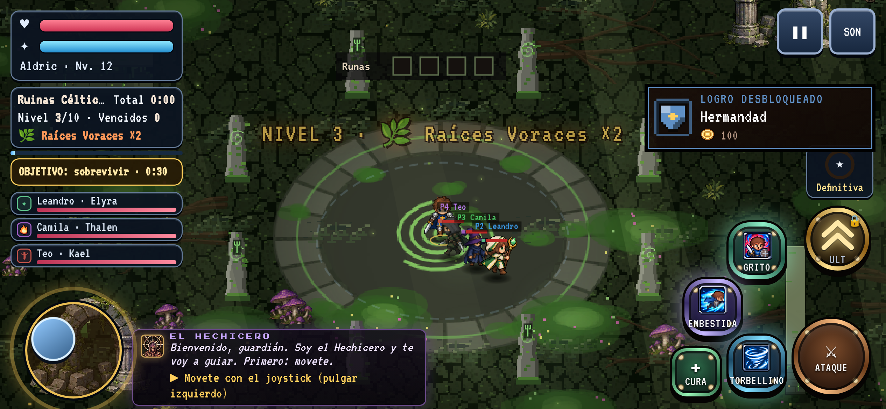
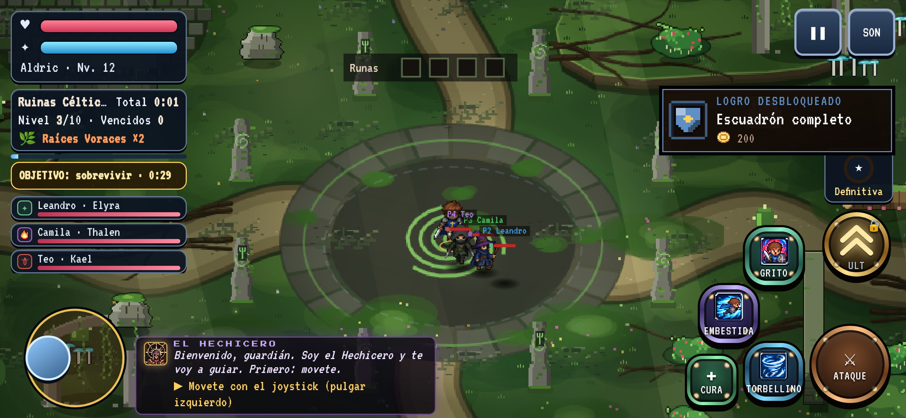
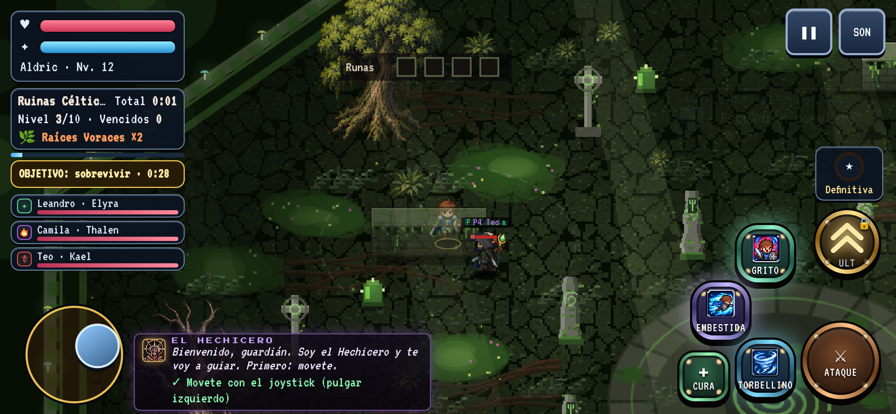
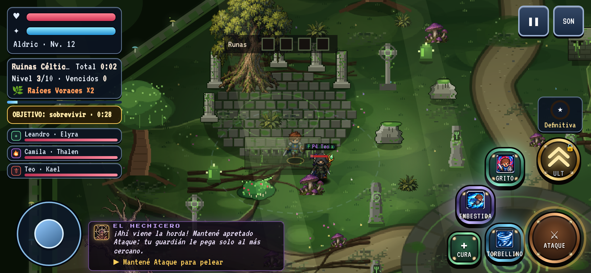
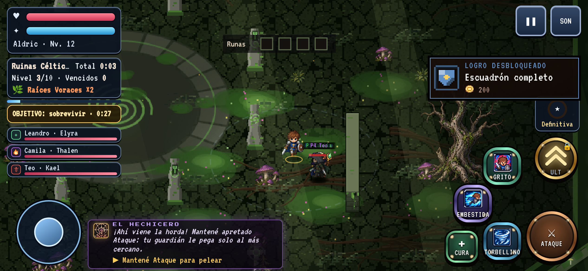
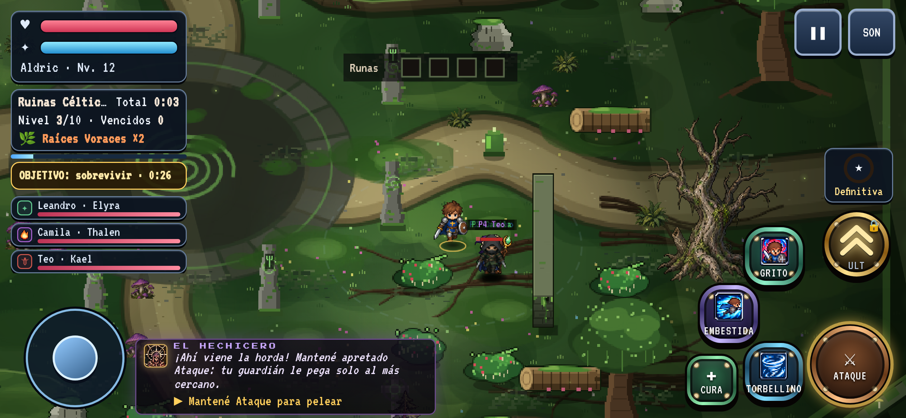
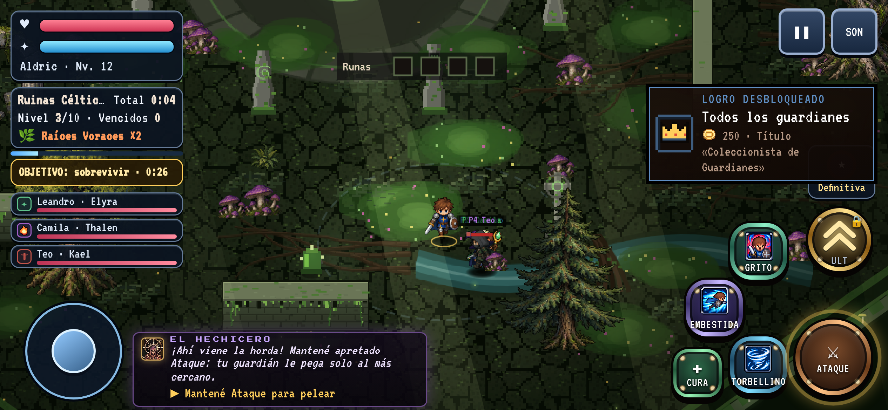
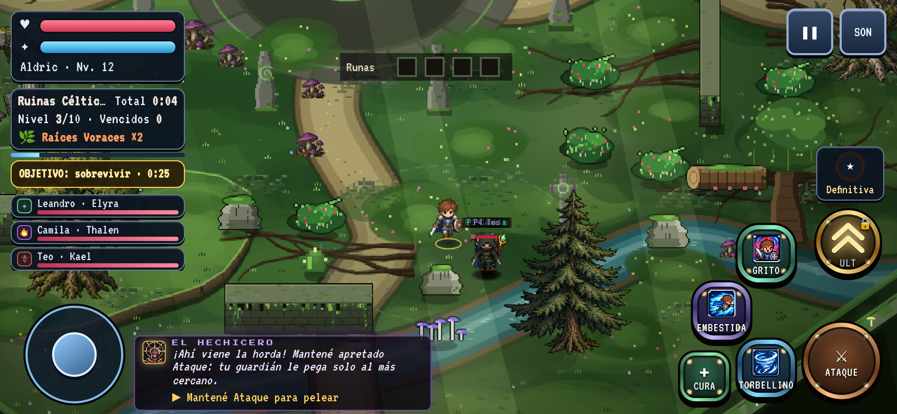
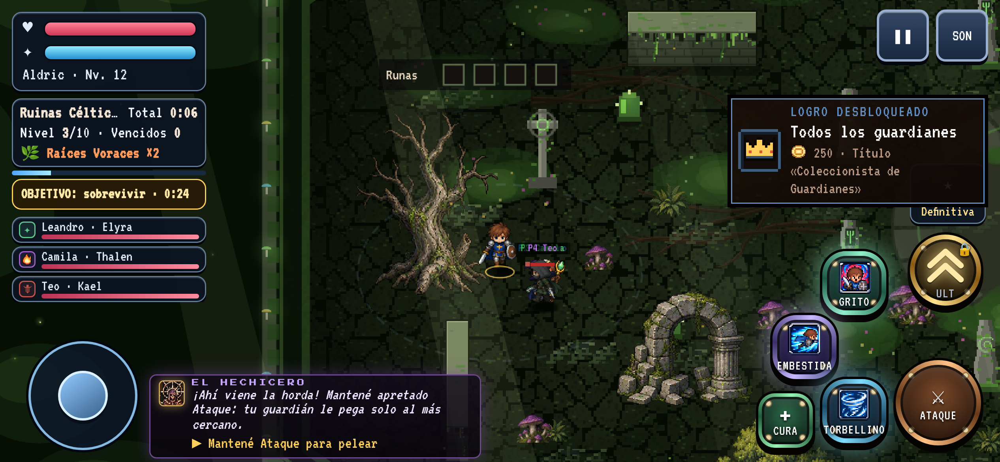
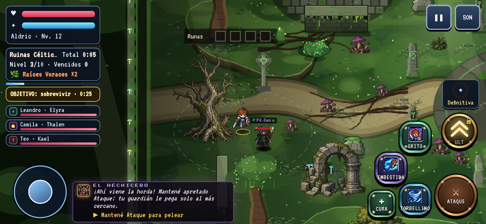

# Ruinas del Bosque — rediseño "selva fantástica" (antes / después)

Rama `claude/mapa-inicial-selva`. Código: `js/arenas/bosque/bos-selva.js` (suelo y obstáculos procedurales propios, sin recursos de terceros),
enganchado en `aidBuildBosque` (arena-identity.js), `drawArena` (rendering/arena.js) y la fase de proyectiles de `update.js`.

> **Aclaración sobre "primera arena de la campaña".** En el código actual `ARENA_ORDER[0]` es `ciudad` (Ciudad Maldita; el bosque es la 3ª, ver `CAMPAIGN_ORDER` en `js/data/arenas.js`).
> El pedido describe un bosque/selva con ruinas, así que se rediseñó **`bosque`** (Ruinas del Bosque). La Ciudad Maldita no se tocó. Si se quería otra arena, hay que decirlo.

## Capturas (Chromium headless 844x390, DPR 3; con HUD y tutorial reales)

| | Antes | Después |
|---|---|---|
| Centro (círculo ritual) |  |  |
| Ruinas del noroeste |  |  |
| Sendero este |  |  |
| Sur / arroyo |  |  |
| Borde oeste |  |  |

## Qué cambió
- **Suelo horneado una vez** (canvas 1340x940 = 0,5 px/unidad; por cuadro solo se dibuja el recorte visible): pasto con parches de tono, 3 terrazas con labio de desnivel (solo visual, se pisan), 4 senderos de tierra clara hacia los accesos, arroyo con vado de piedras, hierba, flores y piedritas. Reemplaza el piso de placas de piedra oscura.
- **Obstáculos con colisión real** (los mismos `aidSolids` que usan héroes, enemigos, campo de flujo, bots y validador): rocas, zarzales, troncos caídos, árboles antiguos extra y un templo en ruinas con columnas rotas. Se colocan con una función que respeta centro, borde, sendero, otros sólidos y **verifica la navegación** (si una pieza encierra una zona alcanzable, se rechaza). Determinístico (sin `Math.random`): el invitado en cooperativo arma lo mismo.
- **Proyectiles:** árboles, menhires, rocas, columnas y muros paran los tiros rectos (enemigos y aliados). Zarzales y troncos son bajos (bloquean el paso, no el tiro). Los tiros en arco (`p.lob`) y los que declaran `p.ignoreTerrain` pasan por encima. **Es un cambio de jugabilidad** (cobertura): revisar con diseño, sobre todo para jefes con proyectiles y bots que disparan detrás de un árbol.
- Lectura: lo caminable es claro y de tono medio; lo que bloquea es más oscuro, con contorno de 1 px y filo iluminado.
- Piezas colocadas con la semilla 11: 9 rocas, 10 zarzales, 3 troncos, 5 columnas, 6 árboles extra (33 piezas, 80 candidatos rechazados por reglas).

## Pruebas corridas (resultados reales, esta rama)
| Prueba | Resultado |
|---|---|
| `node tools/bible/arena-validator.js --strict` con `ARENAS=bosque` (ficha, geometría conexa, "si se ve sólido es sólido", 120 spawns, exploración agresiva, 8 semillas con pilares) | PASS, fail=0 warn=0, 0 errores de página |
| `node tools/art/bosque-selva-test.js` (nuevo) | 9/9 PASS: piezas, determinismo, colisión de cada sólido nuevo, tiro alto bloqueado / bajo no / lob no / ignoreTerrain no, 24/24 enemigos rodean y llegan |
| `tools/identity/t_identity.js` (ONLY=bos,env,tut) | 5 FAIL **también en `origin/main`** (BOS.contener_runa…, BOS.las_raices…, BOS.la_runa_contenida…, TUT.empieza_con_moverse, TUT.moverse_atacar…). Con mis cambios apareció una vez `BOS.emboscada_con_aviso_previo` (minD 198 < 200); en 6 repeticiones posteriores pasó 6/6 (minD 210–276). Esa prueba usa `Math.random` sin semilla: es sensible a más obstáculos (los reintentos acortan la distancia) |
| `tools/ux/test-touch-targets.js`, `functional.js`, `test-arena-briefing-tutorial.js`, `test-hub-legibility.js`, `tools/art/battlefield-test.js` | exit 0 |
| `tools/art/check-environment-inlays.js` | NO corrió: falta el módulo `@napi-rs/canvas` en este entorno |
| `tools/ux/playtest.js` (1 partida, perfil habitual, Bosque) | victoria en 426 s simulados, 748 bajas. Una sola partida: no mide balance. La corrida de 3 perfiles x 2 semillas no se completó |
| `tools/playtest/campaign.js` | no corrida (requiere jobs de `make_jobs.py`) |

## Rendimiento — **NO es una prueba en iPhone real**
Chromium headless (`/opt/pw-browsers/chromium`, Linux, render por software), viewport 844x390, DPR 3 (el juego limita a 2), `Emulation.setCPUThrottlingRate` 1/4/6x, partida real con 3 aliados, el jugador moviéndose con el joystick y la horda persiguiendo. Script: `tools/art/bosque-selva-bench.js`; JSON en `antes*/` y `despues*/`.

El host era compartido y muy ruidoso: el FPS de rAF quedó entre 4 y 22 en **ambas** versiones (en headless el compositor por software domina), así que **el FPS no distingue antes de después**. Mediana de 3 corridas intercaladas (8 s cada una, 1x / 4x / 6x), FPS rAF: antes 6,7 / 8,0 / 6,3; después 7,5 / 7,9 / 6,2. Frame p95 a 4x: antes 200–300 ms, después 183–300 ms.

Medida más limpia: costo de `render()` llamado en forma síncrona (sin compositor), 5 tandas x 400 llamadas, 3 pares intercalados, p50 por tanda y mediana entre tandas:
| CPU | Antes | Después |
|---|---|---|
| x1 | 1,7 / 2,2 / 2,9 ms | 2,9 / 2,8 / 3,0 ms |
| x4 | 0,8 / 3,6 / 4,0 ms | 1,1 / 2,8 / 1,6 ms |

Lectura honesta: a CPU x1 el render del Bosque cuesta del orden de +0,5 a +1 ms por cuadro (más props que ordenar por profundidad y el recorte del suelo); a 4x la dispersión (0,6–9 ms) es mayor que la diferencia, no se puede afirmar nada. No se midió memoria ni un dispositivo real; el suelo horneado ocupa ~5 MB (1340x940x4) y se rehace solo si cambia la semilla del mapa.

## Pendientes
- Probar en un iPhone real (FPS, térmica, memoria del canvas de 5 MB).
- Revisión de arte/diseño de la lectura de obstáculos y del bloqueo de proyectiles (cambio de jugabilidad).
- Decidir si el "primer mapa" debía ser la Ciudad Maldita (ver aclaración arriba).
- Las pruebas fallidas ya en `origin/main` (t_identity) quedan sin tocar.
